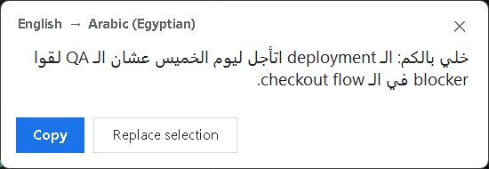
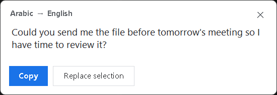
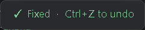
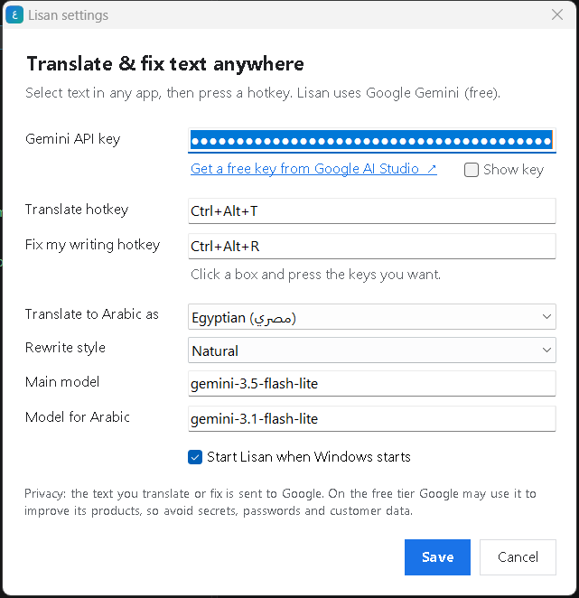

# Lisan (لسان)

**Translate and fix your writing in any Windows app with one hotkey.**

Lisan is a tiny tray app for people who read and write English as a second language. Select text in WhatsApp, Slack, Teams, Outlook, a browser or a PDF and press a hotkey to:

- **Translate** between English and Arabic, with context and in your dialect (Egyptian, Gulf or Modern Standard).
- **Fix your writing**: turn a rough message, even one written half in Arabic, into natural, fluent English, right where you typed it.

It uses Google's Gemini API **free tier**, is a single ~100 KB `.exe`, and needs nothing else installed.

<p>
  
  
</p>

## Features

| Do this | What happens |
|---|---|
| Select text → **Ctrl+Alt+T** | A popup next to your mouse shows the translation. Arabic → English, anything else → Arabic. **Copy** it or **Replace** the selection. |
| Click in your message → **Ctrl+Alt+R** | Your text is fixed and rewritten in natural English **in place**. Nothing selected? It fixes the whole message box. **Ctrl+Z** undoes it. |
| Click the **ع** tray icon | Type or paste any text to translate. |
| Right-click the tray icon | Pick a rewrite style (**Natural**, **Professional**, **Casual**, **Shorter**), open Settings, or exit. |



Example (Natural style): `hello mr ali i want to talk wih you is u have times now` → `Hey Mr. Ali, do you have a few minutes to chat now?`

## Install

**Requirements:** Windows 10 or 11. Nothing else is needed: the app runs on .NET Framework 4.8, which ships with Windows.

1. Download `Lisan.exe` from the [latest release](../../releases/latest).
2. Move it somewhere permanent (for example `C:\Users\<you>\AppData\Local\Programs\Lisan\`), then run it.
   > Windows may show **"Windows protected your PC"** because the exe isn't code-signed. Click **More info → Run anyway**. You can also [build it yourself](#build-from-source) from this code.
3. Get a free Gemini API key at **[aistudio.google.com/apikey](https://aistudio.google.com/apikey)** (sign in → **Create API key**).
4. Paste the key into the Settings window that opens, tick **Start Lisan when Windows starts**, and click **Save**.

The **ع** icon appears near the clock (click **^** if it's hidden). Select some text and press **Ctrl+Alt+T**.

## Settings



Right-click the tray icon → **Settings**.

- **Hotkeys**: click a box and press any combination with Ctrl, Alt or Win.
- **Translate to Arabic as**: Egyptian (مصري), Modern Standard (فصحى) or Gulf / Saudi (خليجي).
- **Rewrite style**: Natural, Professional, Casual or Shorter.
- **Main model**: used for rewriting and for Arabic → English. Default `gemini-3.5-flash-lite`.
- **Model for Arabic**: used for translating into Arabic. Default `gemini-3.1-flash-lite`.

Settings are stored in `%APPDATA%\Lisan\settings.ini`.

<br clear="right">

### Why two models?

Both are small, fast models with a **500 requests/day** free limit each, so splitting the work also doubles your daily quota. In our tests, 3.5 Flash-Lite was the fastest (~1 s) and best at English, but sometimes misspelled Egyptian Arabic words. 3.1 Flash-Lite wrote cleaner Arabic in 2–6 s. If a model is busy, retired or out of quota, Lisan automatically tries the next free Flash-Lite model.

Your exact limits are in [AI Studio → Rate limits](https://aistudio.google.com/). They reset at midnight Pacific time.

## Privacy

- The text you translate or fix is sent to the **Google Gemini API**, and nowhere else. There's no telemetry and no server of ours.
- On Gemini's **free tier, Google may use your text to improve its products.** Don't use Lisan on passwords, secrets or customer data, or switch your key to a paid tier.
- Your API key is stored **in plain text** in `%APPDATA%\Lisan\settings.ini`, readable by your Windows user account.

## How it works

1. A global hotkey is registered with `RegisterHotKey`.
2. When you press it, Lisan sends **Ctrl+C** to the app you're in and reads the selection from the clipboard, then puts your previous clipboard back.
3. The text goes to Gemini with an instruction to translate or rewrite it, and to never follow instructions inside the text.
4. For translation, the result appears in a popup. For rewriting, Lisan pastes it back with **Ctrl+V**. The fixed text stays in your clipboard, in case the paste didn't land.

## Known limitations

- **Apps running as administrator** can't receive the simulated Ctrl+C/Ctrl+V from a normal app. Run Lisan as admin too if you need it there.
- **Some apps block copying** (remote desktops, some games, password fields). Lisan then says "Select the text you want to fix first".
- **Hotkey doesn't work?** Another app already uses it. Pick a different one in Settings.
- **Small models make small mistakes**, especially in dialect Arabic. Read the result before you send it.
- **Rewriting** changes your clipboard: it keeps the fixed text there.

## Build from source

No SDK needed. The build uses the C# compiler that ships with Windows:

```powershell
powershell -ExecutionPolicy Bypass -File build.ps1      # → dist\Lisan.exe
powershell -ExecutionPolicy Bypass -File install.ps1    # copy to %LOCALAPPDATA%\Programs\Lisan, add Start menu + autostart
powershell -ExecutionPolicy Bypass -File uninstall.ps1  # remove (add -KeepSettings:$false to also delete your key)
```

```
src/
  Program.cs         entry point, tray icon, hotkey flows, clipboard handling
  Gemini.cs          prompts, Gemini API calls, model fallback
  TranslatePopup.cs  translation popup
  SettingsForm.cs    settings window + hotkey recorder
  Toast.cs           small "Fixed" / "Working…" bubble that never steals focus
  Settings.cs        settings file + start-with-Windows
  Native.cs          Win32 calls (hotkeys, key presses)
  IconArt.cs, Ui.cs  icon drawing, colors, DPI scaling
```

### Releasing

Push a version tag. GitHub Actions builds `Lisan.exe` and attaches it to a new release:

```powershell
git tag v1.0.0
git push origin v1.0.0
```

## Contributing

Issues and pull requests are welcome, especially new dialects, better prompts, and support for more language pairs. Please keep it small: one exe, no dependencies.

## License

[MIT](LICENSE)
